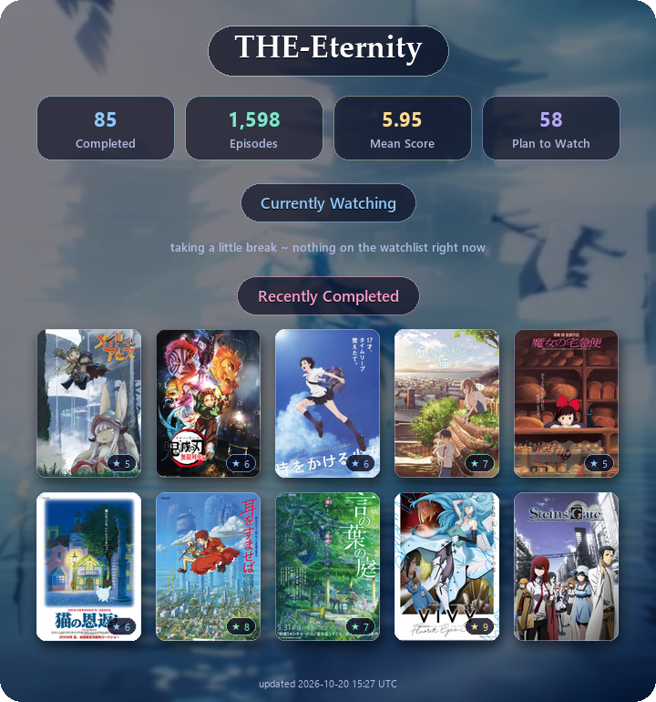

# mal-profile

Auto-updating MyAnimeList profile image for **THE-Eternity**.



GitHub Actions runs `generate.py` every hour. It reads the public anime list, and when something changed
(new completed anime, new score, new watching entry) it rebuilds `profile.png` and commits it.

Use it on MAL (About Me):

```
[center][img]https://raw.githubusercontent.com/thepie9240-crypto/mal-profile/main/profile.png[/img][/center]
```

Run it by hand: **Actions → Update MAL profile image → Run workflow**.
